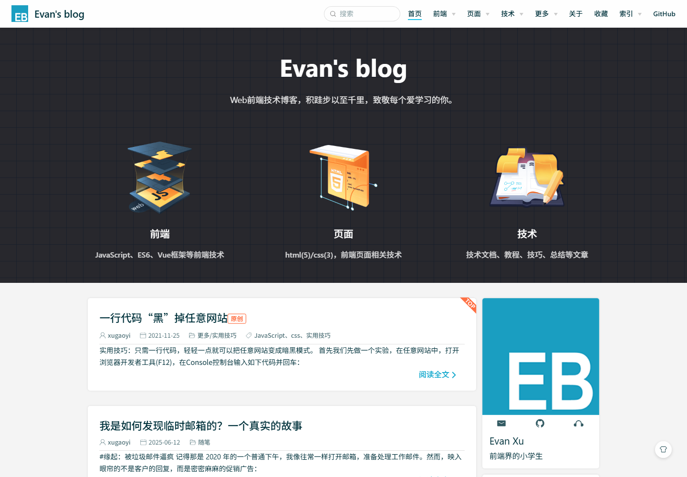
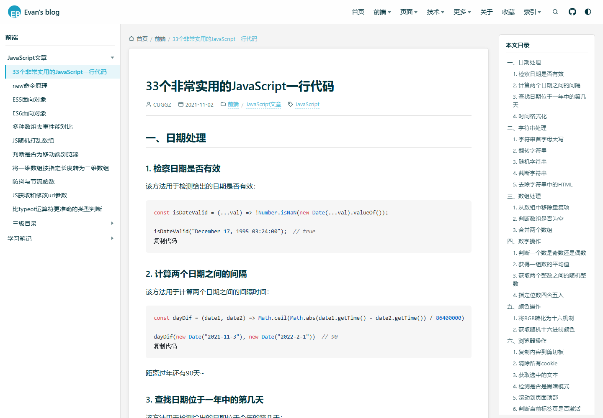
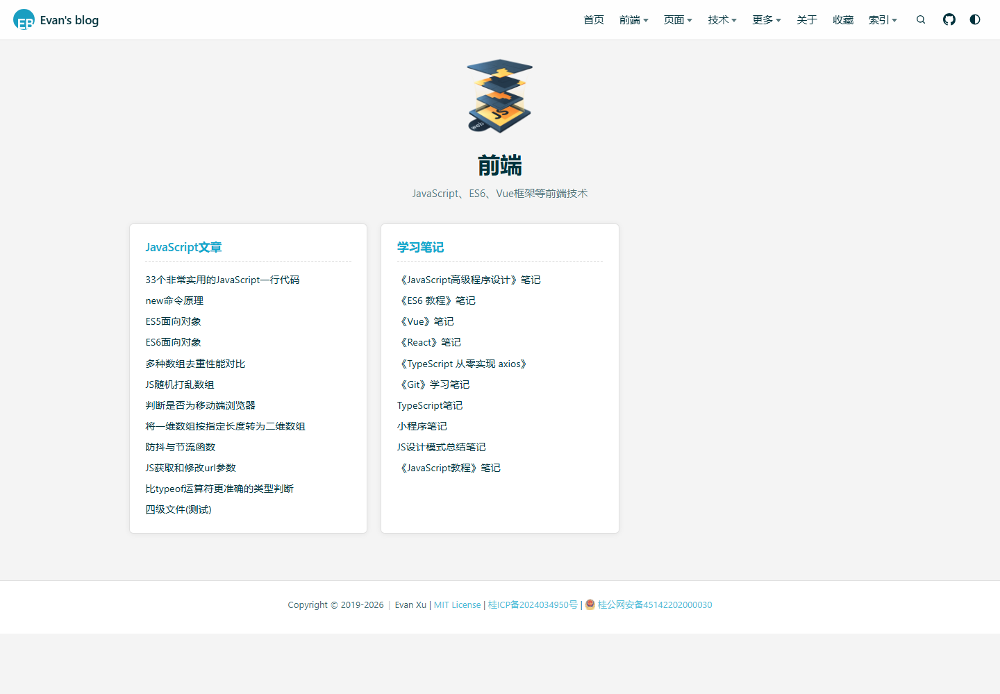
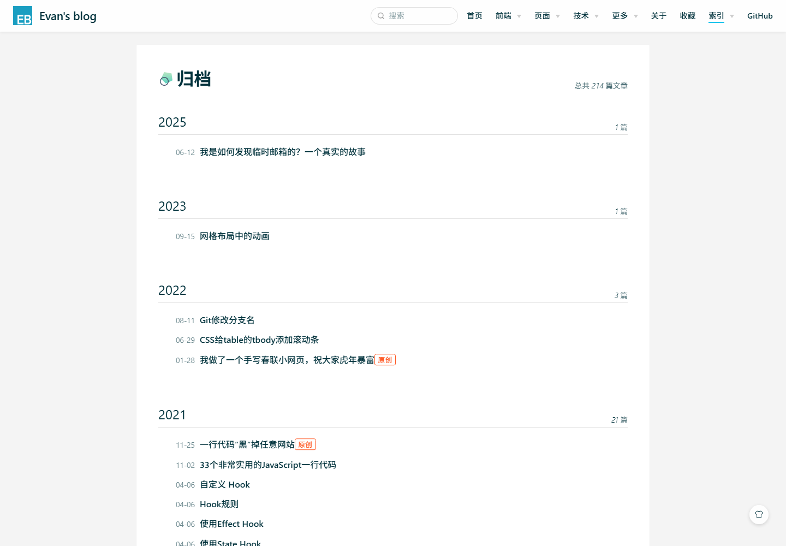
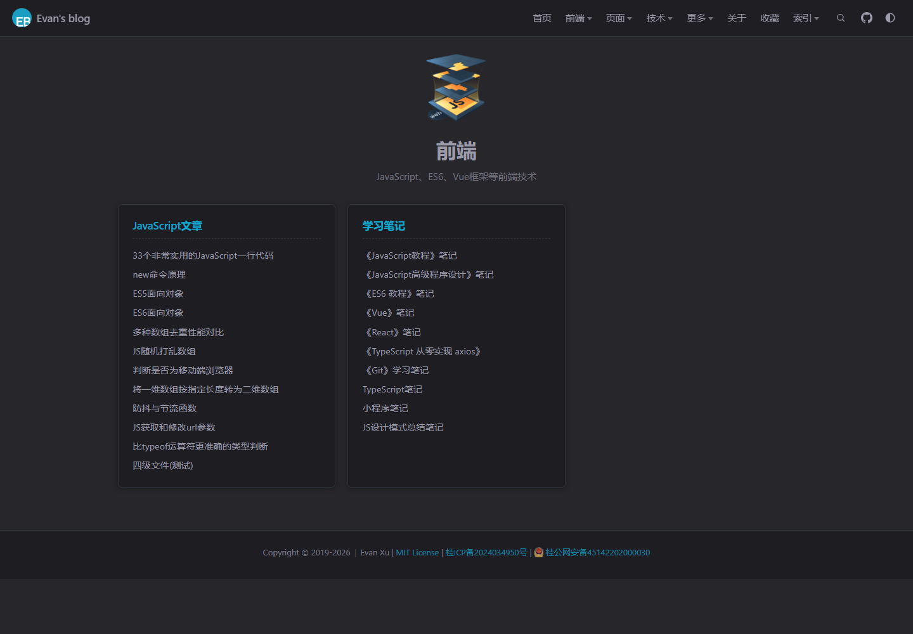

<p align="center"></p>

<h2 align="center">hugo-theme-vdoing</h2>

<p align="center">
  由 <a href="https://github.com/xugaoyi/vuepress-theme-vdoing">vuepress-theme-vdoing</a> 完整迁移而来的 Hugo 主题：知识库 + 博客。
</p>



---

## 这是什么

这个仓库原本是 xugaoyi 的 VuePress 版「vdoing」主题 + 博客工程（已完整保留在 `legacy/` 作为对照）。
现在它是一个 **Hugo 站点 + `themes/vdoing` 主题**：不仅完成了内容迁移，主题的 DOM 结构、样式与交互也按原版 `legacy/vdoing` 逐组件移植并对齐。

- 230 个内容页（其中 214 篇正式文章）全部迁移，**保留原 `/pages/xxx/` 永久链接**，老站外链不失效；
- 保留原版的全部主题配置项（`pageStyle`、`bodyBgImg`、`contentBgStyle`、`titleBadge`、`rightMenuBar`、`pageButton`、`updateBar`、`htmlModules`、`gitalk`、`baidu`、`zooming` …）；
- 原版 vendored 的 iconfont 图标库、标题徽标、Prism 浅色/深色代码主题均已本地化，**不依赖任何外部 CDN**（评论/统计按配置可关）。

| 文章页 | 目录页 |
| --- | --- |
|  |  |

| 归档 | 深色模式 |
| --- | --- |
|  |  |

---

## 与原版对齐的功能

**外壳 / 导航**

- 顶栏 `.navbar.blur`：logo + 站名、搜索框、三层嵌套导航（`data/nav.yaml`，桌面 hover / 移动端点击展开）、当前页高亮、GitHub 仓库链接、向下滚动自动隐藏；
- 左侧边栏：结构化目录树（按 `weight` 排序、可折叠分组、同时只展开当前分支）、`sidebar: auto` 碎片文章显示本页大纲、桌面左缘悬停弹出、收起状态记忆、移动端抽屉 + 遮罩 + 右滑手势；
- 移动端侧边栏博主信息卡（`.blogger`）；
- 右下角圆形按钮组：返回顶部、去评论、主题模式选择框（`auto / light / dark / read` 四项）；
- `bodyBgImg` 背景大图（单图 / 多图轮播 + 透明度）、`theme-style-line` 线条风格、footer 社交图标与备案信息；
- 自定义 HTML 模块（`data/htmlModules.yaml`）：`homeSidebarB` / `sidebarT` / `sidebarB` / `pageT` / `pageB` / `windowLB` / `windowRB`，支持 `*showMode: article|custom`。

**文章页**

- 面包屑（首页 / 顶级目录 → 目录页 / 子目录 → 目录页锚点）、作者 / 日期 / 分类；
- 标题前随机徽标（`titleBadge`，`titleBadgeIcons` 可自定义）、`titleTag` 小徽标、`contentBgStyle` 1~6 内容区背景纹；
- 右侧文章大纲（h2~h6，滚动高亮、点击平滑滚动）、中部左右固定快捷翻页按钮 + tooltip、底部上一篇 / 下一篇；
- 编辑链接（GitHub / GitLab / Gitee 自动识别，`editLink: false` 可关）、标签列表、最近更新时间（`enableGitInfo` 取 git 提交时间）；
- 「最近更新」栏（`updateBar`）、gitalk 评论（`comment: false` 可关）、`pageT` / `pageB` 自定义 HTML 槽位。

**首页 / 列表 / 归档 / 分类 / 标签 / 目录页**

- 首页 banner：网格纹背景、`bannerBg`（auto / none / 图片 / 自定义 CSS）、heroImage / heroText / tagline / actionButton、features 卡片 + 移动端轮播；
- 首页文章列表：`postList: detailed | simple | none`、`sticky` 置顶、`postPageSize` 分页、`hideRightBar`、右侧博主卡 / 分类 / 标签 / `homeSidebarB`；
- 归档页：年份 sticky 分组、总数 / 年度篇数、日期 + 标题 + `titleTag` + 标题徽标；
- 分类 / 标签页：原版 URL 行为 `/categories/?category=xxx`、`/tags/?tag=xxx`（读取 `index.json` 前端过滤 + 分页），term 页兜底；
- 目录页：`column-wrapper`（图片 + 标题 + 描述）+ 原版编号大纲 `1. / 1-1. / 1-1-1.`，`#锚点` 与面包屑联动；
- 404：大号 404 + 随机文案 + 返回首页。

**Markdown 渲染**

- 标题 hover 显示 `#` 锚点；代码块：语言标签、行号（`lineNos = inline`）、`{hl_lines=[..]}` 行高亮、一键复制（自动剔除行号）、`CodeGroup` / `CodeBlock` 标签页；
- 自定义容器：`tip / warning / danger / note / theorem / details / center / right / cardList / cardImgList`（含原版配色、深色适配；`cardList` 直接解析容器内的 YAML 数据渲染成卡片，`demo` 容器带 sandbox iframe 实时预览）；
- `Badge` 短代码、kbd、表格、引用、居中容器等原版排版；图片点击放大（`zooming`）。

**其他**

- 站内搜索（`index.json` 本地过滤，`/` 或 `Ctrl/⌘ + K` 唤起，支持标题 / 正文命中与高亮）；
- 主题模式三套配色 + `auto` 跟随系统，`localStorage` 记忆，`?mode=dark` 直接指定；
- 百度统计 / 百度自动推送 / 百度站长验证 meta、OpenGraph、Twitter Card、RSS、robots.txt、sitemap.xml；
- 打印样式、419 / 719 / 959 / 1279 / 1520 断点响应式。

---

## 快速开始

```bash
# 本地预览（热更新）
hugo server --disableFastRender

# 构建静态站点到 public/
hugo --minify
```

依赖：**Hugo extended 0.156+**（需要 SCSS 编译能力）。

---

## 目录结构

```
.
├── hugo.toml              # 站点配置（站名、主题参数、taxonomy、markup、git 信息）
├── data/
│   ├── nav.yaml           # 顶部导航菜单（支持三层嵌套）
│   └── htmlModules.yaml   # 自定义 HTML 模块（侧边栏 / 页面顶部底部 / 左右下角窗口）
├── content/               # 文章内容（由 VuePress docs/ 迁移而来）
│   ├── _index.md          # 首页（heroText / tagline / features / bannerBg / postList …）
│   ├── archives.md        # 归档页  -> /archives/
│   ├── catalogue/         # 目录页  -> /web/ /ui/ /technology/ /more/
│   ├── posts/             # 碎片化文章（原 _posts/，sidebar: auto）
│   ├── 前端/ 页面/ 技术/ 更多/ 关于/ 收藏夹/
│   └── 《ES6 教程》笔记/ 《Vue》笔记/ …… （学习笔记专辑）
├── static/                # 站点图片、favicon、CNAME、备案图标等
├── themes/vdoing/
│   ├── layouts/           # 模板 / partials / shortcodes / _markup 渲染钩子
│   ├── assets/scss/       # 样式，按区域拆分为 partial（variables/base/navbar/sidebar/article/…）
│   ├── assets/js/         # 交互脚本，构建时按文件名拼接成一个 main.js
│   └── static/            # 主题自带静态资源（iconfont、标题徽标、兜底 css）
├── tools/                 # 迁移与校验脚本（见下文）
├── docs/                  # 截图 + 与 VuePress 版的对齐说明（docs/parity-plan.md）
├── archetypes/default.md  # hugo new 的文章骨架
└── legacy/                # 原 VuePress 工程（含 vdoing 主题源码），仅作参考
```

---

## 写文章

在 `content/` 下任意目录新建 `.md` 文件即可（或 `hugo new content/前端/xxx/新文章.md`）：

```yaml
---
title: 文章标题
date: 2024-05-01T10:00:00+08:00   # 使用带时区的 RFC3339
url: "/pages/abc123/"             # 永久链接，等价于 VuePress 的 permalink
categories: [前端, JavaScript文章]
tags: [JavaScript]
author:
  name: xugaoyi
  link: https://github.com/xugaoyi
weight: 1                         # 同级排序，等价于原文件名 "01." 序号
titleTag: 原创                     # 可选：标题旁小徽标
sticky: 1                         # 可选：置顶，数字越大越靠前
comment: false                    # 可选：关闭本页评论
editLink: false                   # 可选：关闭本页「编辑」链接
sidebar: auto                     # 可选：左侧边栏改为本页大纲（碎片文章）
sidebar: false                    # 可选：关闭左侧边栏
article: false                    # 可选：自定义页（不进列表 / 归档 / 搜索）
---

正文……
```

### 侧边栏与排序

- 左侧边栏 = 当前文章所在**顶级目录**的整棵目录树，顺序由 `weight` 决定（从小到大）；
- 子目录自动变成**可折叠分组**，分组先后由该目录 `_index.md` 的 `weight` 决定；
- 目录本身不生成页面（`_index.md` 中 `build.render: never`），分组标题只负责展开 / 收起。

### 目录页（catalogue）

`content/catalogue/*.md` 用于「前端 / 页面 / 技术 / 更多」这类汇总页：

```yaml
---
layout: catalogue
catalogue: "前端"          # 对应 content/前端 这一顶级目录
imgUrl: /img/web.png
description: JavaScript、ES6、Vue框架等前端技术
url: "/web/"
sidebar: false
article: false
---
```

### VuePress 容器的替代写法

原来的 `::: tip 标题 … :::` 已由迁移脚本转换成 Hugo shortcode：

```markdown
{}
支持 **markdown** 的内容
{}
```

`type` 支持：`tip` / `warning` / `danger` / `note` / `theorem` / `details` / `center` / `right` / `cardList` / `cardImgList` / `demo`；
`cardList` / `cardImgList` 容器内直接放一段 ```yaml 数据即可渲染成原版卡片列表（见 `content/更多/友情链接.md`）。

---

## 主题配置

站点配置在 `hugo.toml` 的 `[params]` 下（注意 TOML 子表要放在普通 key 之后）：

| 参数 | 说明 |
| --- | --- |
| `logo` / `repo` / `repoLabel` / `themeColor` | 导航栏 logo、仓库、仓库链接文字、浏览器 theme-color |
| `pageStyle` | `card` 卡片式 / `line` 线条式（有 `bodyBgImg` 时强制 `card`） |
| `bodyBgImg` / `bodyBgImgOpacity` / `bodyBgImgInterval` | body 背景大图（数组则轮播） |
| `contentBgStyle` | 内容区背景纹 `1~6`，`0` 为无 |
| `titleBadge` / `titleBadgeIcons` | 标题前随机徽标 |
| `sidebarOpen` / `sidebarHoverTriggerOpen` / `sidebarDepth` | 侧边栏初始状态 / 悬停弹出 / 层级 |
| `rightMenuBar` / `pageButton` | 右侧文章大纲 / 页面中部快捷翻页按钮 |
| `defaultMode` | `auto` / `light` / `dark` / `read` |
| `navbar` | 是否显示顶部导航 |
| `postPageSize` / `searchMaxSuggestions` | 首页每页文章数 / 搜索下拉条数 |
| `editLinks` / `editLinkText` / `docsRepo` / `docsDir` / `docsBranch` | 文章底部「编辑本页」 |
| `lastUpdated` | 「上次更新」文案（时间取 git 提交时间） |
| `author` / `authorLink` | 默认作者（文章未指定 `author` 时使用） |
| `category` / `tag` / `archive` / `categoryText` | 分类 / 标签 / 归档开关与碎片文章默认分类 |
| `blogger.{avatar,name,slogan}` | 首页右侧 / 移动端侧边栏博主信息卡 |
| `[[params.social]]` | 社交图标（`iconClass` 取 iconfont 类名，如 `icon-github`） |
| `footer.{createYear,copyrightInfo}` | 页脚版权 / 备案信息 |
| `[params.updateBar]` | 最近更新栏（`showToArticle` / `moreArticle`） |
| `[params.gitalk]` | gitalk 评论（`enable` / `clientID` / `clientSecret` / `repo` / `owner` / `admin` …） |
| `[params.baidu]` | 百度统计 / 自动推送 / 站长验证（留空即关闭） |
| `[params.zooming]` | 图片放大（`enable` / `bgColor` / `selector`） |

自定义 HTML 模块放在 `data/htmlModules.yaml`，顶部导航在 `data/nav.yaml` 中维护（某个条目不写 `link` 即为纯分组标题）。

### 外观模式

- 右下角圆形按钮组的主题选择框：浅色 → 深色 → 阅读 → 跟随系统（`auto`）；
- 也可以用 URL 直接指定：`/?mode=dark`；
- 用户的选择保存在 `localStorage`（键 `vdoing-mode`），未选择过时跟随系统。

### 评论（gitalk）

在 `[params.gitalk]` 填写 GitHub OAuth App 的 `clientID` / `clientSecret`、评论仓库 `repo` / `owner` / `admin` 即可；
文章页 frontmatter 写 `comment: false` 可单独关闭；整站关闭把 `enable` 设为 `false`。

### 站内搜索

构建时首页额外输出 `index.json`（标题、链接、日期、分类、标签、正文摘要），前端输入时做本地过滤，不依赖任何第三方服务。
快捷键：`/` 或 `Ctrl/⌘ + K`。

---

## 与 VuePress 版的差异

**已对齐**：导航 / 侧边栏 / 首页 banner 与文章列表 / 文章页（面包屑、徽标、编辑链接、上次更新、右侧大纲、翻页、最近更新栏）/ 归档 / 分类 / 标签 / 目录页 / 404 / 代码块与自定义容器 / gitalk 评论 / 图片放大 / 三套主题模式 / body 背景图 / 自定义 HTML 模块 / 百度统计等。

**有意不同 / 已知差距**：

- 分类、标签页为「服务端渲染 + 前端 query 过滤分页」，无 JS 时仍可用（原版是纯 SPA 渲染）；
- `demo` 容器为简化的「iframe 预览 + 代码块」，不含原 `vuepress-plugin-demo-block` 的 CodePen 外链与 Vue 实时预览；
- 未接入 Algolia 搜索、第三方搜索跳转（`thirdparty-search`）与 `nprogress` 进度条；
- 图片放大只做「点击查看原图」，不含原版 zooming 的缩放 / 拖拽 / 手势；
- 还有一批 P0~P3 的差距（gitalk 配置键、上/下一篇重复、侧边栏标题子项、`search`/`smoothScroll` 参数空转等）。

完整的逐项对比、证据（两侧 `file:line`）、优先级与修复建议见
**[docs/parity-gaps.md](docs/parity-gaps.md)**（约 280 个功能点，未实现/部分实现 60 余项）。

---

## 从 VuePress 重新迁移 / 开发校验

原 VuePress 工程整体保留在 `legacy/`，迁移与校验脚本都在 `tools/`：

```bash
# 重新生成 content/（会清空重建，谨慎）
python tools/migrate_content.py

# 构建后校验站内链接（0 missing 为通过）
hugo --minify && python tools/check_links.py

# 一键验收：构建 + 链接检查 + 关键页面截图（截图输出到 .tmp/verify-*.png）
powershell -NoProfile -ExecutionPolicy Bypass -File tools/verify.ps1

# 单个页面截图（本地静态服务 + Edge/Chrome headless）
# 视口宽度由 CDP Emulation 精确设定（tools/screenshot.cjs）；不要用浏览器 --window-size 截图，
# 窗口尺寸 ≠ CSS 视口宽度，1279/1280 断点会截出「大纲被裁掉」的假象
tools\screenshot.cmd -BuildDir public -Page "/pages/8143cc480faf9a11/" -Port 8899 -Out .tmp/a.png -Width 1440 -Height 1000
```

> 构建时如需并行/避免构建锁：`hugo --noBuildLock --cacheDir "<绝对路径>/.tmp/cache"`；
> 无外网环境做截图验收时用 `tools/qa.toml` 覆盖配置关闭 gitalk / 百度统计：`--config hugo.toml,tools/qa.toml`。
> 截图依赖本机 Edge/Chrome 与 Node（`tools/screenshot.cjs` 走 CDP，无需 npm 依赖）。
> `docs/parity-plan.md` 记录了与 `legacy/vdoing` 逐组件的对齐方式、文件映射和宽屏布局/截图踩坑记录。

---

## 部署

```bash
hugo --minify      # 产物：public/
```

把 `public/` 部署到任意静态托管（GitHub Pages / Vercel / Netlify / Nginx）即可。原站点的 `CNAME`、备案图标等静态文件已保留在 `static/`。

## 许可证

[MIT](LICENSE) · Copyright (c) 2019-present Evan Xu

原始主题：[vuepress-theme-vdoing](https://github.com/xugaoyi/vuepress-theme-vdoing)
